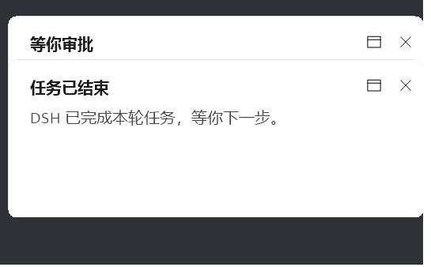

# Notice Card

给 DeepSeek Harness 的一张桌面通知卡：**一轮任务跑完**、**等你审批工具调用**、**等你回答问题**时，屏幕右下角滑出一张卡片，不抢焦点、不打断你正在做的事。

多张卡自动叠成一摞，**最先出现的那张完整显示在最前面**，后来的卡依次往上垫、只露出标题条。




- 纯 Windows 桌面绘制（WinForms + GDI+），不依赖 Windows 通知中心，也不用打开系统通知权限
- `WS_EX_NOACTIVATE` + `TopMost`：盖在所有窗口之上，但永不夺走焦点，全屏视频/游戏里也能看到
- 卡片是独立进程，DSH 忙的时候也照弹；进程崩了也不影响 DSH 本身
- 零网络、零遥测：插件不发任何请求，只在本地起一个 PowerShell 进程画窗口

## 环境要求

| 项目 | 要求 |
| --- | --- |
| 平台 | Windows（`os: win32`） |
| DSH | `>= 0.1.0-rc.1` |
| Node | `>= 20`（只给宿主加载插件用） |
| 运行时 | Windows PowerShell 5.1（系统自带，无需额外安装；**不需要** PowerShell 7） |

> 卡片的脚本用到了 WinForms 与 DPI 感知 API，走的是 5.1 自带的 .NET Framework。仓库不含任何预编译产物，第一次弹卡时插件会自动把一小段 C# 互操作代码编译成 DLL 缓存到 `%LOCALAPPDATA%\dsh-notice-card\NotifyWin.dll`。

## 安装

插件是纯 Host 插件（`dsh.bundle.patch`），有三种装法，按你的 DSH 形态选一种。

### 方式一：手动挂载（所有形态都能用，推荐先用这个验证）

```bash
git clone https://github.com/Maple-Yoli/dsh-notice-card.git
```

打开你的 profile 目录下的 `cordis.patch.yml`（默认在 `%USERPROFILE%\.dsh\profiles\<profile>\cordis.patch.yml`），在末尾追加：

```yaml
- insert:
    - id: notice-card
      name: C:/path/to/dsh-notice-card/lib/index.mjs
      config: {}
```

把 `C:/path/to/dsh-notice-card` 换成你实际的克隆路径，**路径用正斜杠**。

DSH 支持补丁热重载：新增的 `id` 会被立即加载，不用重启。如果没反应，完全退出 DSH 再开一次。

### 方式二：官方桌面端（Electron 应用）

官方桌面端的 `desktop` profile 由应用自己独占，命令行 `dsh plugin --profile desktop add` 会被拒绝。请走应用内的 **设置 → 插件**，用仓库地址安装：

```
Maple-Yoli/dsh-notice-card
```

安装完成后插件作为 bundle 自动挂载，无需手工改 patch。

### 方式三：`dsh web` / 自建 profile

这些 profile 允许命令行装插件：

```bash
dsh plugin add github:Maple-Yoli/dsh-notice-card
```

`reconcilePlugins` 会读到你包里的 `dsh.bundle.patch`，自动把它加进 profile 的 `dsh.profile.bundles`，补丁随之生效。

> 不要同时用两种方式挂载，否则同一个插件会被加载两次、每件事弹两张卡。

## 配置

在 patch 的 `config:` 里传，例如只关掉「任务结束」的提示：

```yaml
- insert:
    - id: notice-card
      name: C:/path/to/dsh-notice-card/lib/index.mjs
      config:
        onTurnEnd: false
        seconds: 20
```

| 键 | 默认值 | 说明 |
| --- | --- | --- |
| `onTurnEnd` | `true` | 一轮任务结束时弹卡 |
| `onApproval` | `true` | DSH 等你审批工具调用时弹卡 |
| `onQuestion` | `true` | DSH 等你回答问题（`ask_user_question`）时弹卡 |
| `seconds` | `10` | 无人操作时卡片存活秒数；有请求在等的卡会提前收起 |
| `turnEndTitle` | `任务已结束` | 任务结束卡的标题 |
| `turnEndBody` | `DSH 已完成本轮任务，等你下一步。` | 任务结束卡的正文 |
| `approvalTitle` | `等你审批` | 审批卡的标题 |
| `approvalBody` | `工具：{tool}{reason}` | 审批卡的正文模板，`{tool}` 为工具名，`{reason}` 为审批理由 |
| `questionTitle` | `等你回答` | 提问卡的标题 |
| `questionBody` | `问题：{question}` | 提问卡的正文模板，`{question}` 为问题文本 |
| `processName` | 自动推断 | 点卡片右上角窗口图标时聚焦的进程名 |
| `appPath` | 自动推断 | 该进程不在时启动的可执行文件路径 |
| `scriptPath` | 包内 `notify.ps1` | 想改绘制逻辑时指向你自己的副本 |

`processName` 与 `appPath` 默认从宿主进程推出来：桌面端下是 `DeepSeek Harness` 和它的 exe 路径。如果你用别的壳跑 DSH，改成对应值即可；两个都留空则窗口图标只关卡片、不聚焦。

### 行为说明

- **不抢焦点**：卡片创建时带 `WS_EX_NOACTIVATE`，并会把焦点还给原来那个窗口。你可以一直打字、一直全屏放视频。
- **点了才关**：点卡片右上角的 `✕` 立即收起；点窗口图标则把 DSH 窗口调到前台。不点的话，`seconds` 秒后淡出。
- **审批卡不会自己消失**：审批/提问的卡会一直挂着，直到应用内面板真的把请求答完，然后才淡出。最少显示 1.2 秒，避免秒闪。
- **压在最上层**：卡片进程自己声明 `HWND_TOPMOST`，跟其他置顶窗口抢顶时可能被挤到后面，属正常现象。

## 卸载

1. 把 `cordis.patch.yml` 里那段 `- insert:` 删掉（方式一/三），或在 设置 → 插件 里卸载（方式二）
2. 删掉缓存：`%LOCALAPPDATA%\dsh-notice-card\`
3. 方式一可以连带删掉克隆目录

## 工作原理

```
一轮结束        → agent/turn-stopping            ┐
等你审批        → approval/request (prepend)     ├→ 起 powershell -File notify.ps1 -Popup
等你回答        → user-questions/request (prepend)┘        ↓
                                                    WinForms 无边框窗口，GDI+ 手绘
```

审批与提问这两个监听器**只是旁听**：它们用 `{ prepend: true }` 挂在瀑布流最前面，弹完卡立刻 `return next()` 把请求交回给原本的应答方（应用内的审批面板）。插件永远不代替你回答，也永远不阻塞请求——`notify()` 全程包在 `try/catch` 里，弹卡失败只会静默吞掉。

`notify.ps1` 是个独立脚本，也能单独用：

```powershell
powershell -NoProfile -ExecutionPolicy Bypass -File lib\notify.ps1 -Popup -Title "标题" -Body "正文" -Seconds 8
```

不带 `-Popup` 时它会再 spawn 一个分离子进程就退出，适合放在 hook 里当命令用（不阻塞调用方）。

## 常见问题

**卡片不弹？**

1. 先确认脚本本身没问题：上面的命令行直接跑一次，能弹就是插件没挂上
2. 插件没挂上：确认 `cordis.patch.yml` 里 `name:` 指向的路径确实存在，且是 `lib/index.mjs`
3. 改了 patch 但没反应：DSH 的补丁热重载只对**新增的 `id`** 生效；改一个已存在的 `id` 的内容不会重载，完全退出 DSH 再开
4. 每次只弹一张、后来的不弹：检查是不是同时用两种方式挂载了两次

**中文变成乱码？**

`notify.ps1` 必须保持 UTF-8 BOM。用编辑器改过之后如果中文显示成乱码，就是把 BOM 弄丢了；重新存成「UTF-8 with BOM」。

**想改卡片的样式？**

`lib/notify.ps1` 里是全部绘制逻辑（圆角、描边、配色、字号、动画时长、叠放间距都在文件顶部和 `New-IconButton` 附近）。改完不用重新装插件，DSH 下次起进程就是新脚本。

## 隐私

- 不发任何网络请求，不写任何统计
- 不收集你的路径、用户名、会话内容
- 与 DSH 的唯一交互就是上面那三个事件，卡片上显示的只有事件自带的工具名/问题文本
- 卡片的 C# 编译产物缓存在 `%LOCALAPPDATA%\dsh-notice-card\`，卸载时删掉即可

## License

[MIT](LICENSE)

---

## English

A focus-free notice card for DeepSeek Harness on Windows. It slides into the bottom-right corner when a turn finishes, when DSH is waiting for a tool approval, or when it is waiting for an answer to a question. Cards stack, oldest one front and fully visible.

Pure host plugin: `agent/turn-stopping`, `approval/request` and `user-questions/request` → a detached PowerShell process draws a borderless WinForms window with GDI+. No notification-center permission, no network, no telemetry. The approval/question listeners only observe and delegate with `next()` — the built-in UI still answers.

Requires Windows, Node >= 20, and Windows PowerShell 5.1 (ships with Windows; PowerShell 7 is not needed). Clone the repo and add an insert to your profile's `cordis.patch.yml` pointing `name:` at the absolute path of `lib/index.mjs`; on the official Electron desktop app, install it from **Settings → Plugins** instead. See the Chinese section above for the full config table.
